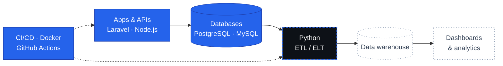
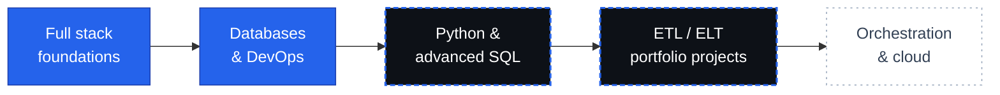

  

  
  
  

  
  
  

---

## Profil / Profile

<table>
<tr>
<td width="50%" valign="top">

**Français**

Étudiante en Technologies de l'Informatique à l'**IUC** (Douala), spécialisée en programmation d'applications mobiles, et titulaire d'un DEC en Programmation Informatique (CCNB, Canada).

Développeuse full stack, je m'oriente vers le **data engineering** : bases de données fiables, services qui produisent des données propres, chaînes de livraison automatisées (CI/CD, conteneurs, supervision).

**Objectif :** rejoindre une équipe data comme data engineer (stage, alternance ou premier poste).

</td>
<td width="50%" valign="top">

**English**

Computer Science student at **IUC** (Douala, Cameroon), specializing in mobile application development, with a DEC in Computer Programming (CCNB, Canada).

A full stack developer moving towards **data engineering**: reliable databases, services that produce clean data, and automated delivery pipelines (CI/CD, containers, monitoring).

**Goal:** join a data team as a data engineer (internship, work-study or first position).

</td>
</tr>
</table>

---

## Stack

  <b>Données / Data</b> 
    
  <b>Backend / APIs</b> 
    
  <b>DevOps</b> 
    
  <b>Frontend / Mobile</b> 
  

Python et SQL avancé : en apprentissage actif / Python and advanced SQL: actively learning

---

## Architecture data cible / Target data architecture

Mes projets applicatifs produisent déjà les données ; je construis maintenant la suite de la chaîne.
My applications already produce the data; I am now building the rest of the chain.

Bleu plein : acquis · pointillé bleu : en cours · gris : prochaine étape &nbsp;|&nbsp; Solid blue: done · dashed blue: in progress · grey: next

---

## Projets / Projects

<table>
<tr>
<td width="50%" valign="top">

<a href="https://github.com/NaelleNangmo/CamwaterApp"><b>CamwaterApp</b></a> 
Facturation d'eau : abonnés, factures générées par tranches de consommation, journal de traçabilité. 
<i>Water billing: subscribers, tiered invoicing, audit trail.</i>  

</td>
<td width="50%" valign="top">

<a href="https://github.com/NaelleNangmo/suivi-academic-backend"><b>suivi-academic-backend</b></a> 
API de suivi académique avec CI/CD, conteneurs, supervision, journalisation et 35 tests. 
<i>Academic tracking API with CI/CD, containers, monitoring, logging and 35 tests.</i>  

</td>
</tr>
<tr>
<td width="50%" valign="top">

<a href="https://github.com/NaelleNangmo/ZommaApp"><b>ZommaApp</b></a> 
Gestion centralisée de dépôts de boissons : stocks, ventes, livraisons, rôles, export CSV des rapports. 
<i>Centralized beverage depot management: stock, sales, deliveries, roles, CSV report export.</i>  

</td>
<td width="50%" valign="top">

<a href="https://github.com/NaelleNangmo/nethastock-mobile"><b>NethaStock</b></a> 
Application mobile de stock multi-sites : inventaires, transferts, tableaux de bord par rôle. 
<i>Multi-site stock mobile app: inventories, transfers, role-based dashboards.</i>  

</td>
</tr>
</table>

---

## Feuille de route / Roadmap

---

## Activité GitHub / GitHub activity

  
  

  

  

---

  <a href="mailto:naellenangmo@gmail.com">naellenangmo@gmail.com</a> ·
  <a href="https://www.linkedin.com/in/naelle-nangmo-5450b7366">LinkedIn</a> ·
  <a href="https://naellenangmo.github.io/">Portfolio</a>

